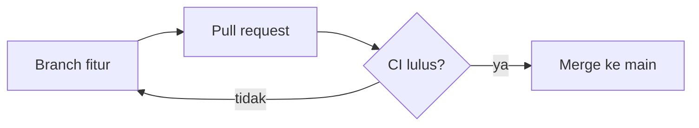

# Toko Buku

[](https://github.com/utsman-kiatkoding/toko-buku/actions/workflows/ci.yml)

Proyek latihan Git dan GitHub: katalog buku dan perhitungan harga.
Dibuat untuk latihan course Git dan GitHub.

> [!NOTE]
> Repository ini hanya untuk latihan. Datanya fiktif.

## Fitur

| Modul | Fungsi |
| --- | --- |
| `harga.py` | Menghitung harga akhir setelah diskon |
| `stok.py` | Mengelola stok buku |
| `pencarian.py` | Mencari buku berdasarkan judul |

## Roadmap

- [x] Hitung harga dan diskon
- [x] Stok dan kategori buku
- [x] CI dengan GitHub Actions
- [ ] Wishlist buku
- [ ] Halaman katalog di GitHub Pages

## Cara menjalankan

Jalankan `python3 harga.py` untuk melihat contoh harga akhir:

```bash
python3 harga.py
python -m unittest -v
```

## Alur kerja



## Berkontribusi

Baca [CONTRIBUTING.md](CONTRIBUTING.md) sebelum membuka pull request.
